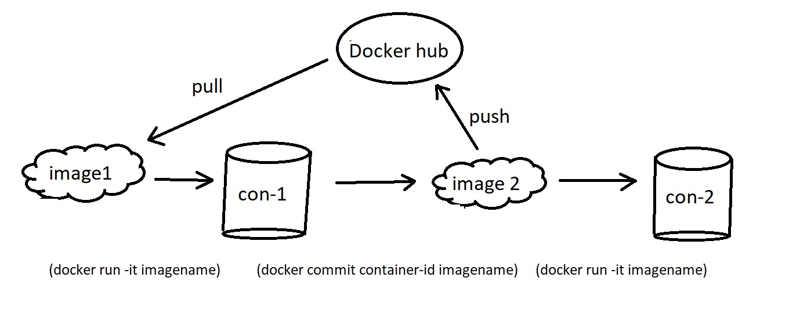
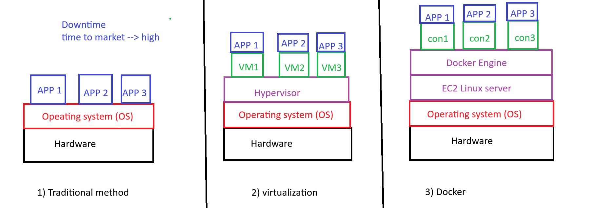
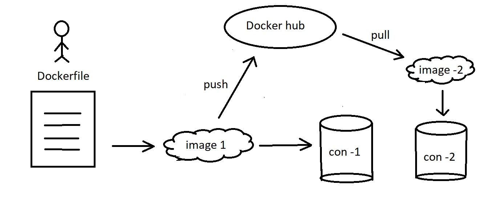

# Docker & Virtualization – Practical Learning Notes

A beginner-friendly reference covering **virtualization, hypervisors, Docker, images, containers, registries, Docker commands, Dockerfiles, Docker Compose, and Docker Swarm**.

These notes are based on the supplied class material and diagrams. The commands are written for Linux environments; package installation commands can vary by distribution and Docker installation method.

---

## Table of Contents

1. [Virtualization](#1-virtualization)
2. [Hypervisors](#2-hypervisors)
3. [Docker Fundamentals](#3-docker-fundamentals)
4. [Docker Registries](#4-docker-registries)
5. [Docker Architecture: VM vs Container](#5-docker-architecture-vm-vs-container)
6. [Docker Installation](#6-docker-installation)
7. [Essential Docker Commands](#7-essential-docker-commands)
8. [Container Networking, Volumes and Monitoring](#8-container-networking-volumes-and-monitoring)
9. [Docker Images and Dockerfile](#9-docker-images-and-dockerfile)
10. [Docker Compose](#10-docker-compose)
11. [Docker Swarm](#11-docker-swarm)
12. [Quick Command Cheat Sheet](#12-quick-command-cheat-sheet)
13. [Learning Practice](#13-learning-practice)
14. [Source Material](#14-source-material)

---

## 1. Virtualization

**Virtualization** is the process of creating multiple virtual machines (VMs) using a hypervisor. It allows multiple virtual computing environments to share the resources of one physical machine.

### Advantages
- Reduced capital and operating costs.
- Minimized or eliminated downtime.
- Increased IT productivity and efficiency.

### Disadvantages
- Setup and management can take time.
- Poor resource allocation can waste resources.
- Software designed for one environment may not work in another environment.

### Types of Virtualization
1. Desktop virtualization
2. Application virtualization
3. Server virtualization
4. Storage virtualization
5. Network virtualization
6. OS virtualization
7. Hardware virtualization

---

## 2. Hypervisors

A **hypervisor** is software that creates and manages virtual machines.

### Type 1 – Bare-metal hypervisor

Installed directly on the physical hardware.

Examples:
- VMware ESXi
- KVM (Kernel-based Virtual Machine)
- Xen

### Type 2 – Hosted hypervisor

Installed on top of an existing operating system.

Example:
- Oracle VirtualBox

> **Technical clarification:** Type 1 hypervisors run directly on hardware; they do not require a conventional host operating system underneath them. Some platforms provide a separate management environment.

---

## 3. Docker Fundamentals

**Docker** is an open platform for developing, shipping, and running applications. It packages applications and their dependencies into containers.

### Important terms

| Term | Meaning |
|---|---|
| Image | A read-only template used to create containers. |
| Container | A runnable instance of an image. |
| Dockerfile | A text file containing instructions to build an image. |
| Docker Engine | The software that builds and runs containers. |
| Registry | A service used to store and distribute images. |
| Docker Compose | A tool for defining and running multi-container applications. |
| Docker Swarm | Docker's native clustering and service orchestration feature. |

Containers package application code, binaries, libraries, configuration, and dependencies. They are isolated from one another and are generally lighter than full virtual machines because they share the host OS kernel.

### Advantages of Docker
- Lightweight compared with full virtual machines.
- Containers can be created quickly.
- Images can be reused.
- No need to reserve a fixed amount of RAM for every container in advance.
- Helps package applications consistently across environments.

### Limitations to consider
- Applications requiring a full desktop GUI may not be a good fit for containers.
- Large container environments require orchestration and monitoring.
- Container workloads depend on compatible host-kernel and platform support.

---

## 4. Docker Registries

Docker images are stored in registries.

- **Public registry:** Images can be publicly accessed.
- **Private registry:** Access is restricted to authorized users or systems.

**Docker Hub** is a commonly used public image registry.

```bash
# Download an image from a registry
docker pull ubuntu

# Upload an image to a registry after logging in and tagging it
docker push YOUR_DOCKERHUB_USERNAME/YOUR_IMAGE_NAME
```



---

## 5. Docker Architecture: VM vs Container

The supplied diagram compares a traditional application setup, virtualization, and Docker.



### At a glance

| Virtual Machine | Docker Container |
|---|---|
| Runs a guest OS for each VM. | Shares the host OS kernel. |
| Includes a hypervisor layer. | Runs through the Docker Engine/container runtime. |
| Usually uses more resources. | Usually lightweight and starts quickly. |
| Useful for different OS environments and stronger OS-level isolation. | Useful for packaging and deploying applications consistently. |

---

## 6. Docker Installation

The supplied class notes use the following Amazon Linux / yum-style installation commands:

```bash
sudo yum install -y docker
sudo systemctl start docker
sudo systemctl enable docker
docker --version
sudo systemctl status docker
```

For Ubuntu, use Docker's official installation instructions for the supported Ubuntu release rather than assuming the `yum` command is available.

---

## 7. Essential Docker Commands

### Check Docker and list resources

```bash
docker --version
docker -v
sudo systemctl status docker

# List locally available images
docker images
docker image ls

# List running containers
docker ps
docker container ls

# List all containers, including stopped containers
docker ps -a
docker container ls -a
```

### Pull images

```bash
docker pull ubuntu
docker pull centos
docker pull ubuntu:22.04
```

### Create and run containers

```bash
# Run a container (the command/process determines whether it stays running)
docker run ubuntu

# Run a specific image tag
docker run ubuntu:20.04

# Create an interactive container and open Bash
docker run -it ubuntu bash

# Run in detached mode
docker run -itd ubuntu bash

# Create a container with a custom name
docker run --name container1 -it ubuntu bash
```

### Enter an existing container

```bash
# Open a new shell in a running container
docker exec -it CONTAINER_ID_OR_NAME bash

# Attach to the container's main process
docker attach CONTAINER_ID_OR_NAME
```

`docker exec` is generally the better choice when you simply need another shell in a running container.

### Exit or detach

```bash
# Exit the shell; if it is the main process, the container may stop
exit
```

Press **Ctrl + P**, then **Ctrl + Q** to detach from an interactive container while leaving it running (when supported by the attached session).

### Start and stop containers

```bash
docker start CONTAINER_ID_OR_NAME
docker stop CONTAINER_ID_OR_NAME

# Stop multiple containers
docker stop CONTAINER_1 CONTAINER_2
```

### Remove containers and images

```bash
# Remove a stopped container
docker rm CONTAINER_ID_OR_NAME

# Force-remove a running or stopped container
docker rm -f CONTAINER_ID_OR_NAME

# Remove multiple containers
docker rm -f CONTAINER_1 CONTAINER_2

# Remove an image (no containers may be using it)
docker rmi IMAGE_NAME

# Force-remove an image
docker rmi -f IMAGE_NAME

# Remove unused data, including unused images
docker system prune -a -f
```

> **Caution:** `docker system prune -a -f` can delete unused images, stopped containers, networks, and build cache. Review what will be removed before running it on a system you care about.

### Rename a container

```bash
docker rename OLD_CONTAINER_NAME NEW_CONTAINER_NAME
```

---

## 8. Container Networking, Volumes and Monitoring

### Port mapping

Publish a container port on the host:

```bash
docker run -d --name web -p 8080:80 nginx
```

Format: `-p HOST_PORT:CONTAINER_PORT`.

For example, host port `8080` forwards traffic to port `80` inside the container. Open the relevant host/cloud firewall or security-group port only when required.

### Volume / directory mapping

Mount a host directory into a container:

```bash
docker run -it --name volume-demo \
  -v /host/path:/container/path ubuntu bash
```

This allows data to be shared between the host and container. Ensure the host directory exists and permissions are appropriate.

### Container resource usage and logs

```bash
# Live CPU, memory, network and block I/O statistics
docker stats CONTAINER_ID_OR_NAME

# Follow container logs
docker logs -f CONTAINER_ID_OR_NAME

# General Docker system information
docker info
```

### Apache example inside Ubuntu

```bash
docker run -it -p 8080:80 ubuntu:22.04 bash

apt-get update -y
apt-get install -y apache2
echo "Hello from Docker" > /var/www/html/index.html
apachectl -D FOREGROUND
```

Open `http://HOST_IP:8080` after ensuring the host firewall/security group permits port `8080`.

---

## 9. Docker Images and Dockerfile

A **Dockerfile** is a text file containing instructions used to build a Docker image. The conventional filename is `Dockerfile` (capital **D**, no extension).

### Common Dockerfile instructions

| Instruction | Purpose |
|---|---|
| `FROM` | Selects the base image. |
| `LABEL` | Adds metadata to the image. |
| `EXPOSE` | Documents the port the application listens on. |
| `WORKDIR` | Sets the working directory for subsequent instructions. |
| `ENV` | Sets environment variables. |
| `ARG` | Defines build-time variables. |
| `COPY` | Copies files from the build context into the image. |
| `ADD` | Copies files and supports additional features such as local archive extraction. |
| `RUN` | Executes commands while building the image. |
| `CMD` | Supplies the default command/arguments when a container starts. |
| `ENTRYPOINT` | Configures the main executable for the container. |

### Example 1: Simple Dockerfile

```dockerfile
FROM ubuntu:22.04
RUN echo "Hello all" > /file1
```

### Build an image

Run the command from the directory containing the Dockerfile:

```bash
docker build -t image1 .
```

### Create a container from the image

```bash
docker run -it --name test-container image1 bash
```

### Example 2: Install packages

```dockerfile
FROM ubuntu:22.04

RUN apt-get update -y && \
    apt-get install -y tree git apache2 && \
    rm -rf /var/lib/apt/lists/*
```

Combining related package operations into one `RUN` instruction can reduce image layers and help keep the image smaller.

### Shell form and exec form

**Shell form:**

```dockerfile
RUN mkdir /dir1
RUN touch /file1
```

**Exec form:**

```dockerfile
RUN ["mkdir", "/dir1"]
RUN ["touch", "/file1"]
```

Exec form is also commonly used for `CMD` and `ENTRYPOINT`.

### CMD and ENTRYPOINT example

```dockerfile
FROM ubuntu:22.04
CMD ["sleep", "infinity"]
```

Or:

```dockerfile
FROM ubuntu:22.04
ENTRYPOINT ["sleep"]
CMD ["infinity"]
```

`CMD` provides a default command or arguments. `ENTRYPOINT` defines the main executable; a `CMD` can provide its default arguments. A Dockerfile should normally define one effective `CMD` and one `ENTRYPOINT`.

### Create an image from a container

```bash
docker commit CONTAINER_ID_OR_NAME my-custom-image:1.0
```

For repeatable builds, prefer maintaining a Dockerfile rather than relying on `docker commit`.

### Push a custom image to Docker Hub

```bash
# Build and tag the image
docker build -t YOUR_DOCKERHUB_USERNAME/my-image:1.0 .

# Authenticate
docker login

# Push
docker push YOUR_DOCKERHUB_USERNAME/my-image:1.0
```



---

## 10. Docker Compose

**Docker Compose** is a tool for defining and running applications that use multiple containers. It uses a YAML file, commonly named `compose.yaml`, and treats each container configuration as a service.

YAML uses indentation and key-value structures:

```yaml
key: value
```

### Install Compose plugin (Linux example)

The supplied notes use a manual plugin download approach. Follow the official Docker Compose installation instructions for the current recommended method for your distribution.

### Example 1: Two services

Create a file named `compose.yaml`:

```yaml
services:
  one:
    image: ubuntu:24.04
    command: tail -f /dev/null

  two:
    image: centos:centos7
    command: tail -f /dev/null
```

Run and inspect:

```bash
docker compose up -d
docker compose ps
docker compose exec one bash
docker compose down
```

### Example 2: Ubuntu + Apache

```yaml
services:
  ubuntu-apache:
    image: ubuntu:22.04
    container_name: ubuntu_apache_server
    ports:
      - "8080:80"
    volumes:
      - ./website:/var/www/html
    environment:
      - DEBIAN_FRONTEND=noninteractive
    command: >
      bash -lc "apt-get update &&
                apt-get install -y apache2 &&
                echo 'ServerName localhost' >> /etc/apache2/apache2.conf &&
                echo 'hello all' > /var/www/html/index.html &&
                apachectl -D FOREGROUND"
```

Run it:

```bash
docker compose up -d
docker compose ps
docker compose logs -f ubuntu-apache
docker compose down
```

Visit `http://HOST_IP:8080` if the host port is reachable.

> The `centos:centos7` example is retained from the supplied class notes. CentOS 7 is end-of-life; use a currently supported base image for new projects.

---

## 11. Docker Swarm

Docker Swarm is used to manage services across a cluster of Docker Engine nodes.

### Nodes and ports from the supplied notes

| Node role | Ports |
|---|---|
| Manager | `22`, `2377`, `7946`, `4789` |
| Worker | `22`, `7946`, `4789` |

| Port | Purpose |
|---|---|
| `22/tcp` | SSH administration |
| `2377/tcp` | Swarm cluster management |
| `7946/tcp` and `7946/udp` | Node communication / gossip |
| `4789/udp` | Overlay network traffic |

Restrict these ports to the required cluster nodes and trusted administration sources. Do not expose cluster-management ports to the public internet.

### Install and start Docker on all nodes

```bash
sudo yum install -y docker
sudo systemctl enable --now docker
```

### Initialize the manager

Run on the manager node:

```bash
docker swarm init --advertise-addr MANAGER_PRIVATE_IP
```

### Join worker nodes

On the manager, retrieve the worker join command:

```bash
docker swarm join-token worker
```

Run the generated `docker swarm join ...` command on each worker node.

### List nodes

```bash
docker node ls
```

### Create a service

```bash
docker service create \
  --name myapp \
  --replicas 2 \
  --publish published=8080,target=80 \
  nginx
```

Inspect services:

```bash
docker service ls
docker service ps myapp
```

### Scale a service

```bash
docker service scale myapp=3
docker service scale myapp=5
docker service scale myapp=3
```

### Rolling update

```bash
docker service update \
  --image nginx:latest \
  --update-parallelism 1 \
  --update-delay 10s \
  myapp
```

### Roll back an update

```bash
docker service rollback myapp
```

### Auto-healing demonstration

If a task/container is removed or a node fails, Swarm attempts to maintain the requested service replica count, subject to available cluster capacity.

```bash
docker service ps myapp
```

---

## 12. Quick Command Cheat Sheet

| Task | Command |
|---|---|
| Docker version | `docker --version` |
| Pull image | `docker pull ubuntu` |
| List images | `docker images` |
| List running containers | `docker ps` |
| List all containers | `docker ps -a` |
| Run interactive container | `docker run -it ubuntu bash` |
| Enter running container | `docker exec -it CONTAINER bash` |
| Start container | `docker start CONTAINER` |
| Stop container | `docker stop CONTAINER` |
| Remove container | `docker rm CONTAINER` |
| Remove image | `docker rmi IMAGE` |
| Build image | `docker build -t IMAGE_NAME .` |
| View logs | `docker logs -f CONTAINER` |
| Monitor resources | `docker stats` |
| Start Compose app | `docker compose up -d` |
| Stop Compose app | `docker compose down` |
| List Swarm nodes | `docker node ls` |
| List Swarm services | `docker service ls` |

---

## 13. Learning Practice

Try these exercises in a test environment:

- [ ] Install Docker and verify the service is running.
- [ ] Pull the `ubuntu` image and list local images.
- [ ] Run an interactive Ubuntu container and explore it.
- [ ] Run an Nginx container with host port `8080` mapped to container port `80`.
- [ ] Use `docker exec` to open a shell in a running container.
- [ ] Create a Dockerfile that installs a package and builds a custom image.
- [ ] Tag and push an image to your Docker Hub account.
- [ ] Create a two-service Compose application.
- [ ] Set up a small Swarm cluster using private networking and test scaling.

---

## 14. Source Material

The repository includes the supplied class diagrams and source notes:

- `assets/virtualization-vs-docker.png`
- `assets/docker-image-container-flow.jpeg`
- `assets/dockerfile-build-push-pull-flow.jpeg`
- `source-notes/Docker.txt`
- `source-notes/Docker_Swarm.txt`

The README organizes the provided material into a GitHub-friendly learning guide. A few technical clarifications and safer command examples have been added where the original class notes were oversimplified or outdated.

---

## Disclaimer

These notes are for learning and lab practice. Check the official Docker documentation and your Linux distribution's documentation before using commands in production. Review destructive commands, firewall rules, image versions, and registry permissions before execution.
